# Awesome-Augmented-Analytics-BI 📊 🧠

  

  
  
  
  
  
  

---

## 🌟 Top Augmented Analytics & BI Ecosystem 🚀

**Curated Directory of Enterprise AI BI Platforms & Open-Source Augmented Analytics Tools**  
*Focused on Natural Language Query (NLQ), Automated Insights, Predictive Analytics, AI Copilots, Semantic Modeling & Self-Hosted Augmented Business Intelligence.*

**Last updated: October 2026** 📅

---

### 📌 Overview & Market Analysis 💡

Welcome to the ultimate curated directory of **augmented analytics platforms**, **open-source AI-powered business intelligence (BI) tools**, and **conversational data analytics frameworks**. Whether you are evaluating enterprise-grade commercial platforms (such as *Microsoft Power BI Copilot*, *Salesforce Tableau Pulse*, and *ThoughtSpot Sage*) or lightweight, self-hostable open-source BI solutions (like *Grafana*, *Apache Superset*, *Metabase*, and *PyGWalker*), this directory provides comprehensive pricing, free tier limits, market valuation, and repository star metrics.

**Market Size & Dynamics:**  
> 📈 **Market Size & Structure:** The global Augmented Analytics and AI BI market is estimated at **$18.4 Billion in 2026** (projected to reach **$38.5 Billion by 2030** at a CAGR of ~20.2%). The sector is **moderately fragmented**: mega-cap cloud suite vendors (Microsoft, Salesforce/Tableau, Google/Looker) dominate broad enterprise deployments, while specialized AI-native decision intelligence vendors (ThoughtSpot, Tellius/Kaiya) and fast-growing open-source solutions (Grafana, Superset, Metabase) capture significant specialized, developer-first, and privacy-focused market share.

**Key Ecosystem Highlights:**
- 🔷 **Power BI Copilot** requires **Fabric capacity** (F2 or higher starting at ~$262/month PAYG) — **Pro or PPU licenses alone are insufficient**, and regional availability applies.
- 📊 **Tableau Pulse** delivers automated metrics directly into Slack, Teams, and email — requiring **Tableau Cloud/Server Creator/Explorer licenses** ($42–$115/user/month) and **Tableau+** for AI features.
- 🟢 **Qlik Insight Advisor & AutoML** democratize predictive analytics with automated model creation and full explainability for business users starting at $825/month for Cloud Analytics.
- 🧠 **Tellius / Kaiya** provides conversational decision intelligence with multi-model LLM backends (Gemini + OpenAI) starting at $1,500/month.
- 🔓 **Apache Superset**, **Metabase**, **Grafana**, and **PyGWalker** offer robust open-source alternatives with self-hosted options, embedded SDKs, and zero license costs for core editions.

---

## 📑 Table of Contents
- [🏢 SaaS & Commercial Platforms](#-saas--commercial-platforms)
- [🔓 Open-Source GitHub Projects](#-open-source-github-projects)
- [🛠️ How to Contribute](#%EF%B8%8F-how-to-contribute)
- [📊 Star History](#-star-history)
- [🤝 Support & Sponsorship](#-support--sponsorship)
- [⚠️ Disclaimer](#%EF%B8%8F-disclaimer)

---

## 🏢 SaaS & Commercial Platforms

*Sorted by Market Valuation / Company Size (Descending)* 📉

> 💡 **Sector Analysis:** The global Augmented Analytics market size is estimated at **$18.4 Billion in 2026** and is **moderately fragmented**, featuring a mix of multi-trillion dollar tech giants (Microsoft, Salesforce) offering integrated AI copilots and high-growth decision intelligence specialists (ThoughtSpot, Tellius).

| SaaS / Commercial Platform | Company / Owner | Market Valuation / Scale | Standard Edition Starting Price | Free Tier & Trial Limits | Description |
| :--- | :--- | :--- | :--- | :--- | :--- |
| **[Microsoft Power BI Copilot](https://powerbi.microsoft.com/)** 🔷 | Microsoft | **~$3.90 Trillion** | **$10 / user / month** (Pro) + Fabric F2 Capacity (**$262 / month** PAYG) | **Free Power BI Desktop** (local only); Fabric 60-day Free Trial (up to 1 million capacity units) | **Microsoft-native augmented BI** — Natural language Q&A, automatic report creation, narrative summaries, and DAX query generation. *Copilot requires Fabric capacity.* |
| **[Salesforce Tableau Pulse](https://www.tableau.com/products/tableau-pulse)** 📊 | Salesforce | **~$250 Billion** | **$42 / user / month** (Tableau Cloud Explorer; Pulse AI requires **Tableau+**) | **14-day Free Trial** of Tableau Cloud (up to 25 users); no perpetual free tier | **Enterprise BI with generative AI** — Automated metric digests delivered directly into Slack, Teams, and email. Pulse AI features are bundled into Tableau+ subscription tier. |
| **[Salesforce Einstein Analytics](https://www.salesforce.com/products/analytics/)** ☁️ | Salesforce | **~$250 Billion** | **$75 / user / month** (CRM Analytics Growth edition) | **30-day Free Trial** (includes sample dataset & dashboards); no perpetual free tier | **CRM-native augmented analytics** — Embedded AI predictions, automated data prep, and predictive modeling via Einstein Discovery directly within Salesforce CRM. |
| **[Sisu Data](https://sisu.ai/)** 📈 | Snowflake (Acquired) | **~$50 Billion** (Snowflake) | **$3.00 / Credit** (Snowflake Enterprise pricing context) | **30-day Free Trial** with **$400 in free credits** on Snowflake Data Cloud | **Decision intelligence engine** — Automated key driver analysis and diagnostic ML on high-dimensional cloud data warehouse tables. |
| **[ThoughtSpot Sage](https://www.thoughtspot.com/)** 🔍 | ThoughtSpot | **~$4.00 Billion** | **$95 / month** (ThoughtSpot Team Plan for up to 5 users) | **30-day Free Trial** (full access to search & NLQ features with sample data) | **Search-driven AI analytics** — Natural language query interface powered by GPT, automated chart generation, AI narrative insights, and data modeling synonyms. |
| **[Qlik Insight Advisor](https://www.qlik.com/)** 🟢 | Qlik | **~$3.00 Billion** | **$825 / month** (Qlik Cloud Analytics Standard, up to 25GB reload/yr) | **30-day Free Trial** of Qlik Cloud Analytics (full NLQ & AutoML feature access) | **AI-powered BI & AutoML assistant** — Conversational analytics, automatic chart recommendations, narrative commentary, and explainable AutoML model building. |
| **[Domo AI](https://www.domo.com/)** 🟡 | Domo | **~$1.00 Billion** | **$300 / month** (Domo Enterprise / Consumption Base starting tier) | **30-day Free Trial** (includes 1,000 data credits and full feature access) | **Business Cloud with embedded AI** — AI Chat with @-mention context, multi-dataset synthesis, automated dashboard creation, and unstructured document analysis. |
| **[Sisense Fusion AI](https://www.sisense.com/)** 🟣 | Sisense | **Private (~$1 Billion)** | **$10,000 / year** (Starting SMB annual subscription tier) | **30-day Free Trial** (access to Compose SDK, embedded NLQ, and AI Chatbot) | **Embedded analytics with AI** — AI Chatbot, NLG Insights, NLQ query builder, and React component integration via Sisense Compose SDK. |
| **[Pyramid Analytics](https://www.pyramidanalytics.com/)** 🔺 | Pyramid Analytics | **Private (~$800 Million)** | **$30 / user / month** (Pyramid Professional User license) | **30-day Free Trial** (access to decision intelligence platform and AutoML) | **Decision intelligence platform** — AI-assisted data prep, automated statistical analytics, natural language query builder, and enterprise semantic layer. |
| **[Tellius / Kaiya](https://www.tellius.com/)** 🧠 | Tellius | **Private (~$250 Million)** | **$1,500 / month** (Tellius Starter Tier up to 5 users) | **14-day Free Trial** (access to Kaiya NLQ engine & driver analysis) | **AI-native decision intelligence** — Kaiya conversational BI engine supporting multi-model LLM backends (Gemini + OpenAI), automated root-cause analysis, and embedded NLQ. |

---

## 🔓 Open-Source GitHub Projects

*Sorted by GitHub Stars Count (Descending)* 🌟

- **[Grafana](https://github.com/grafana/grafana)**   
  **Operational monitoring and observability leader**, AGPL-3.0 licensed. **Default dashboard for Prometheus, InfluxDB, Elasticsearch, and dozens of time-series backends**. Massive plugin ecosystem, production-grade alerting, and large community. Strong for real-time KPI monitoring. Grafana Cloud free tier generous; paid from **$29/month**. 📈

- **[Apache Superset](https://github.com/apache/superset)**   
  **The most complete open-source BI platform**, Apache-2.0 licensed. **40+ chart types, full SQL editor, and broadest warehouse coverage** — native connectors for Snowflake, BigQuery, Databricks, Redshift, Postgres, MySQL, Trino, ClickHouse, and 40+ more via SQLAlchemy. Semantic layer built around datasets and reusable metrics. dbt manifest integration. Embedded SDK included free. Stateless web tier scales horizontally. The default open-source answer for Tableau-class dashboarding. 🚀

- **[Metabase](https://github.com/metabase/metabase)**   
  **Most popular business analytics tool by GitHub stars**, AGPL-3.0 licensed. **Single JAR file deployment** — `java -jar metabase.jar`. Visual query builder translates clicks into SQL for non-technical users. OSS static embedding free with "Powered by Metabase" badge; Pro Interactive Embedding unlocks white-label, RLS, and SSO. Best for teams where the people asking questions are not the people who write SQL. 🎯

- **[Redash](https://github.com/getredash/redash)**   
  **SQL-first query and dashboard tool**, BSD-2-Clause licensed. **Does one thing**: write SQL, render charts, pin to dashboards. Supports 35+ data sources. No visual query builder, no semantic layer. ⚠️ *Maintenance concern*: Databricks acquired Redash in 2020; development slowed. Choosing Redash in 2026 is a bet on a community fork or established legacy deployment. ⚠️

- **[Cube](https://github.com/cube-js/cube)**   
  **Universal semantic layer and API platform**, Apache-2.0 licensed. Provides semantic data modeling, caching, pre-aggregations, and access control APIs between data warehouses and front-end visualization engines. Cube Cloud Starter starts at **$40/dev/mo**. The strongest building block for building custom data products and embedded dashboards. 🧊

- **[PyGWalker](https://github.com/Kanaries/pygwalker)**   
  **Python library for exploratory data analysis**, Apache-2.0 licensed. Turn Pandas, Polars, or DuckDB DataFrames into a Tableau-style interactive visual exploration interface directly inside Jupyter Notebooks or Streamlit apps. Zero configuration required. 📊

- **[Evidence](https://github.com/evidence-dev/evidence)**   
  **Code-first analytics with Markdown**, MIT licensed. Build reports and dashboards by writing Markdown with embedded SQL queries — Git-versioned and statically deployable to Vercel/Netlify. Best for developer-centric data teams and code-first data storytelling. 📝

- **[Lightdash](https://github.com/lightdash/lightdash)**   
  **dbt-native BI platform**, MIT licensed. Reads your dbt project directly — models, metrics, dimensions, and descriptions automatically become an explorable self-service BI layer without redefining metrics in a separate tool. Lightdash Cloud starts free for small teams. 🔧

- **[Graphic Walker](https://github.com/Kanaries/graphic-walker)**   
  **Embeddable visual analytics React component**, MIT licensed. Composable, embeddable analysis components for React applications. Drag-and-drop chart builder backed by DuckDB for fast local/edge computation with SQL pushdown to ClickHouse, StarRocks, or Snowflake. 🎨

- **[Rill](https://github.com/rilldata/rill)**   
  **Fast, code-first BI for DuckDB and ClickHouse**, Apache-2.0 licensed. Powered by DuckDB for instant local metrics exploratory dashboards. Transforms raw event streams and Parquet/CSV files into interactive dashboard applications with microsecond response times. ⚡

- **[Knowage](https://github.com/KnowageLabs/Knowage-Server)**   
  **Comprehensive open-source enterprise analytics suite**, AGPL-3.0 licensed. Combines traditional relational data and big data sources. Features data preparation, self-service ad-hoc reporting, spatial/GIS analytics, and Smart Intelligence module with embedded R/Python scripts for machine learning. 🏛️

- **[Zaturn](https://github.com/kdqed/zaturn)**   
  **AI Co-Pilot for conversational data analytics**, MIT licensed. Chat directly with data tables — no SQL or Python needed. Connects to PostgreSQL, SQLite, DuckDB, MySQL, ClickHouse, SQL Server, CSV, and Parquet to automatically render charts and analytical summaries. 🤖

---

## 🛠️ How to Contribute

Contributions are welcome! Follow these steps to submit new augmented analytics platforms or open-source BI software:

1. 🍴 **Fork** the repository.
2. 📝 **Add/edit** entries in `README.md` maintaining table/list structure and formatting.
3. 🔗 Include project title, official website/GitHub link, exact star badge, license, and brief description.
4. 🚀 Submit a **Pull Request** with a descriptive summary of your changes.

---

## 📊 Star History

---

## 🤝 Support & Sponsorship

If you find this augmented analytics and BI repository useful, please consider supporting the project:

- ⭐ **Star** this repository to increase visibility!
- 🔀 **Fork** and share with fellow data engineers, analytics leaders, and open-source advocates.
- ☕ **Sponsor & Buy Me a Coffee**: Support ongoing open-source curation via the [GitHub Sponsor Dashboard](https://github.com/sponsors/ishandutta2007).

---

## ⚠️ Disclaimer

- This is a **community-curated** list — not exhaustive and not an endorsement. ℹ️
- **Power BI Copilot requires Fabric capacity** — Pro/PPU licenses alone are insufficient. **Tableau Pulse AI features are restricted to Tableau+**.
- **Open-source is not free** — Metabase, Superset, and Grafana have zero license cost for self-hosting, but require operational infrastructure, maintenance, and administration.
- **Always validate AI-generated insights** — LLM-powered BI tools can produce hallucinations. Always verify metrics against your enterprise semantic model and source warehouse before making executive decisions. 🧠

---

  <b>Made with ❤️ for data engineers, analytics leaders, and open-source augmented BI advocates.</b>

